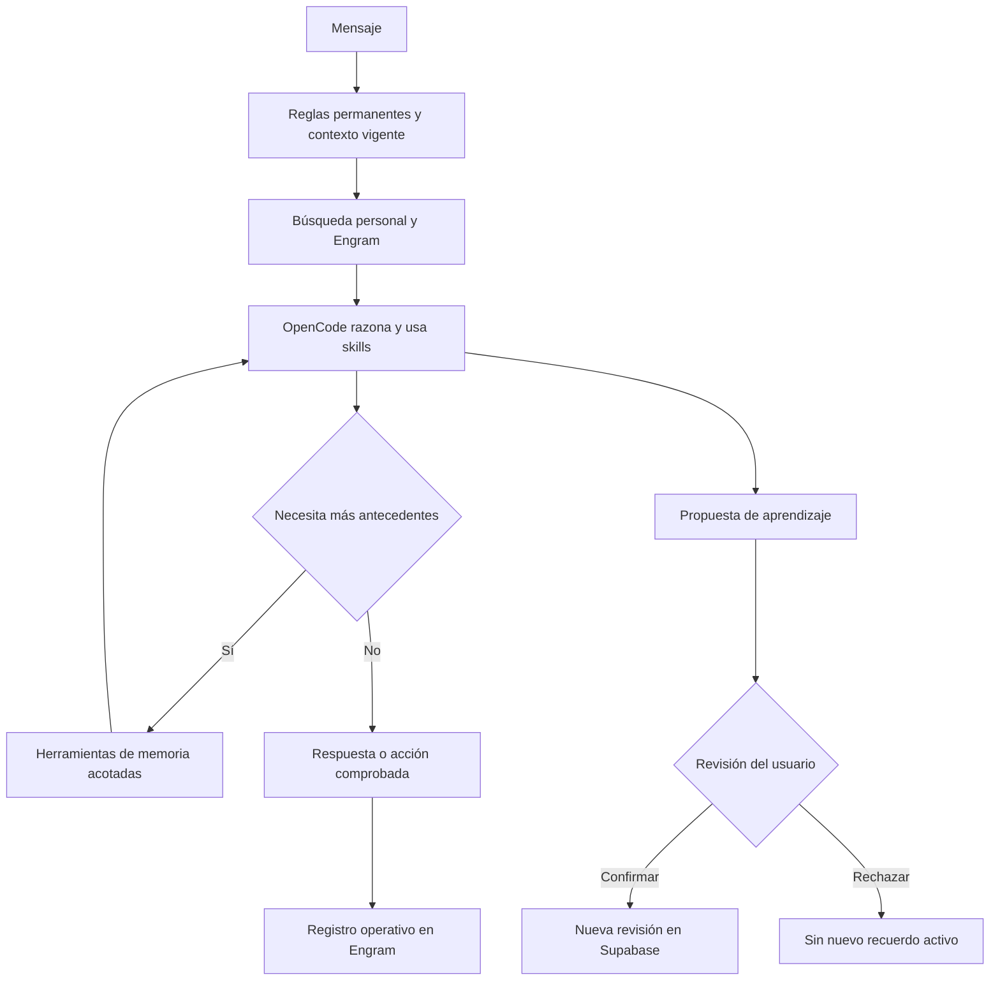

# Comportamiento de NANI

## Separación mínima

| Archivo                                    | Uso                                                                                                 |
| ------------------------------------------ | --------------------------------------------------------------------------------------------------- |
| `.opencode/nani.md`                        | Identidad, tono, iniciativa, honestidad y selección de fuentes; inyectado siempre por la aplicación |
| `.opencode/skills/nani-context/SKILL.md`   | Continuidad y contexto; también inyectado siempre                                                   |
| `.opencode/skills/nani-learning/SKILL.md`  | Propuestas y correcciones, cargada por el agente cuando corresponde                                 |
| `.opencode/skills/nani-execution/SKILL.md` | Ejecución con comprobación, cargada por el agente cuando corresponde                                |
| `.opencode/tools/nani-memory.ts`           | Herramientas reales de búsqueda, lectura y propuesta                                                |
| `AGENTS.md` y `standards/`                 | Guía para trabajar en el repositorio, sin duplicar toda la biografía                                |

Las skills no entrenan al modelo ni garantizan conducta por sí solas. La aplicación asegura la carga del comportamiento esencial y aplica en servidor los límites de acceso y confirmación. OpenCode selecciona las otras skills según sus descripciones.

## Flujo

## Contrato de herramientas

- `nani-memory_search`: query y offset; devuelve hasta ocho extractos de 1.200 caracteres, ID, tópico, fecha, certeza, alcance y fuentes. Puede paginar; no acepta propietario ni SQL.
- `nani-memory_get`: ID; mismos filtros, hasta 16.000 caracteres, indicando truncamiento.
- `nani-memory_propose`: tema, título, contenido, cita, tipo y alcance PERSONAL/PROJECT. Solo propuesta; no puede activar, aprobar ni borrar.

El ID de sesión de runtime lo aporta el contexto nativo de OpenCode, no un argumento del modelo. El puente local comprueba que el turno esté activo y usa la identidad/proyecto/modelo asociados por el servidor. No es una API remota autenticada ni un sandbox frente a otros programas locales.

OpenCode se conecta desde la raíz de NANI para descubrir herramientas y skills. `NANI_WORKING_DIRECTORY` es el destino de trabajo indicado al agente; si está fuera de la raíz, debe resolver rutas explícitas y solicitar permisos de directorio externo. Para programar allí debe leer su AGENTS.md antes de cambios.

No instalar estas reglas en la configuración global de OpenCode: afectarían sesiones ajenas a NANI. No usar el endpoint de memoria desde una sesión CLI independiente: requiere el turno creado por la aplicación.

Referencias: [skills](https://opencode.ai/docs/skills/), [custom tools](https://opencode.ai/docs/custom-tools/), [rules](https://opencode.ai/docs/rules/).
